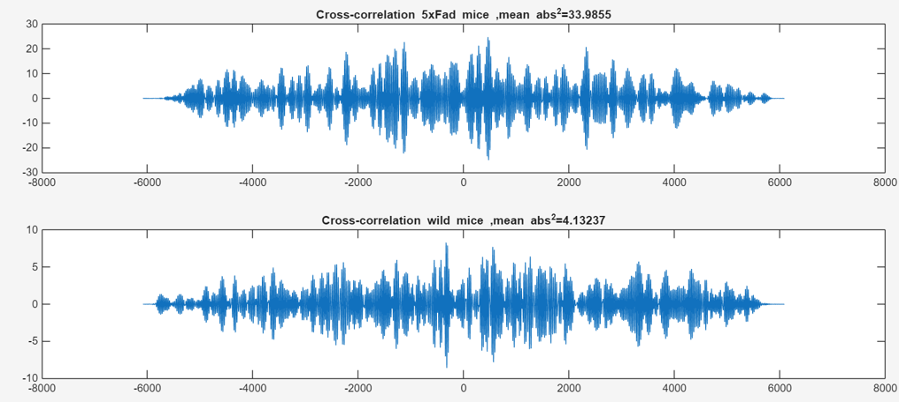
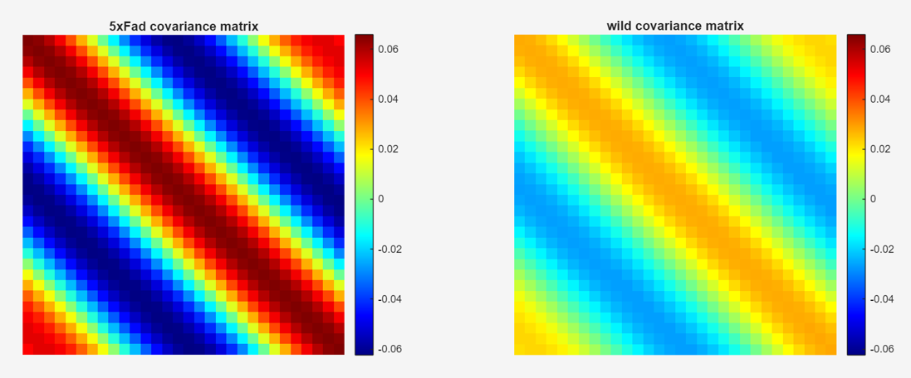
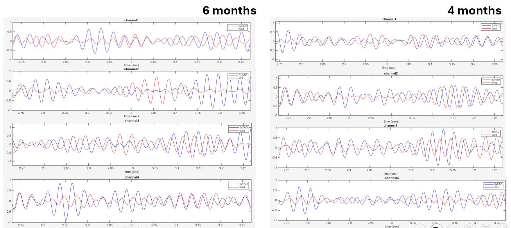

# EEG Analysis of an Alzheimer's Disease Mouse Model

Final-year B.Sc. project in Electrical Engineering, Ariel University (2025–2026).
Advisor: Prof. David Abuksis.

## Overview

This project compares multi-channel EEG recordings from **5xFAD mice** (a mouse model of
Alzheimer's disease) and **wild-type mice** at **4 and 6 months** of age. The goal is
to find signal-level differences between the groups and to see how they change
as the disease progresses.

Recordings have 4 hippocampal/cortical channels sampled at about 1 kHz.

## Pipeline

1. **Segment averaging.** Each recording is split into 6-second segments. The
   segments are averaged within each mouse, then across mice in each group.
2. **Band-pass filtering.** A Hamming-window FIR filter (order 500) isolates one EEG
   band (delta, theta, alpha, beta or gamma).
3. **Singular Spectrum Analysis (SSA).** The filtered signal is embedded in a
   trajectory matrix (window M = 30). Its lag-covariance matrix is
   eigen-decomposed, and the signal is rebuilt from its strongest
   reconstructed components (RCs).
4. **Cross-correlation.** For each group, the leading SSA component at 6 months
   is cross-correlated with the one at 4 months. This measures how stable the
   signal stays over time.

## Results



The 4-month and 6-month signals were much more similar to each other in 5xFAD mice
than in wild-type mice (mean squared cross-correlation 33.99 vs. 4.13). This
suggests reduced neural signal variability as the disease progresses.

| Lag-covariance matrices | Reconstructed signal per channel |
|---|---|
|  |  |

## Repository structure

```
config.m                  shared settings (data path, band, SSA window, ...)
run_4m.m                  analysis of the 4-month recordings
run_6m.m                  analysis of the 6-month recordings
compare_4m_6m.m           cross-correlation between ages
src/
  prepare_average_data.m  segment and group averaging
  analyze_band.m          filtering, SSA and plots for one EEG band
  ssa_decompose.m         Singular Spectrum Analysis
  bandpass_filter.m       FIR band-pass filter
  band_limits.m           EEG band frequency limits
figures/                  result figures
```

## How to run

1. Set `DATA_ROOT` and `BAND` in `config.m`.
2. Run `run_4m.m`, then `run_6m.m`.
3. Run `compare_4m_6m.m`.

Requires MATLAB with the Signal Processing Toolbox.

## Data

The raw EEG recordings belong to the research lab and are not included in this
repository.
